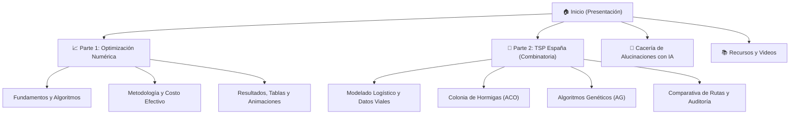

# Trabajo 1: Optimización Numérica, Metaheurística y Combinatoria

Bienvenido al blog y portal técnico del **Trabajo 1** de la asignatura **Redes Neuronales y Algoritmos Bioinspirados**.

Este portal presenta de manera interactiva, rigurosa y visual el estudio comparativo entre métodos basados en gradiente y metaheurísticas bioinspiradas aplicados a:
1. **Optimización Numérica No Convexa y Multimodal:** Análisis de descenso por gradiente (analítico, numérico y backtracking), algoritmos evolutivos, enjambre de partículas (PSO) y evolución diferencial (DE) sobre las funciones de Rosenbrock y Rastrigin en $\mathbb{R}^2$ y $\mathbb{R}^3$.
2. **Optimización Combinatoria de Gran Escala:** Resolución del Problema del Viajero (TSP) asimétrico sobre las 47 capitales de provincia de la España peninsular, modelando distancias y tiempos reales de carretera vía OSRM, tarifas de peaje vigentes y costos laborales y de combustible, comparando algoritmos de Colonia de Hormigas (ACO) y Algoritmos Genéticos (AG).
3. **Auditoría de IA:** Sistematización del uso de modelos de lenguaje grande y cacería de alucinaciones matemáticas.

---

## Información del Proyecto

- **Institución:** Facultad de Minas — Universidad Nacional de Colombia, Sede Medellín.
- **Curso:** Redes Neuronales y Algoritmos Bioinspirados (Semestre 2026-2).
- **Docente:** Juan David Ospina Arango.
- **Fecha:** Octubre de 2026.

### Integrantes
- **Gian Carlo Mier Estrada**
- **Juan Jose Sanchez Mejia**
- **Nestor Enrique Mendoza Rueda**

---

## Estructura del Blog

El contenido se encuentra dividido en los siguientes módulos accesibles desde la barra superior:

!!! tip "Enlaces rápidos y código"
    - Repositorio oficial en GitHub: [Redes-Neuronales-y-algoritmos-Bionispirados](https://github.com/Gmiercrack/Redes-Neuronales-y-algoritmos-Bionispirados)
    - Carpeta de videos con las sustentaciones individuales: [Google Drive de Sustentaciones](https://drive.google.com/drive/folders/1hp3Bd6TGe0t1FEH5LlFKd0gPjSxsjq5S)
