# Resultados Experimentales y Discusión Comparativa

A continuación se presentan los resultados consolidados de las 30 corridas independientes por algoritmo sobre las funciones de Rosenbrock y Rastrigin en 2D y 3D, evaluando tanto la calidad de la solución como el esfuerzo computacional.

---

## 1. Resultados en Dimensión 2

### 1.1 Función de Rosenbrock 2D
En Rosenbrock 2D, el mínimo global está en $(1, 1)$ con $f^* = 0$. La curvatura y mal condicionamiento del valle ($\kappa \approx 2{,}5 \times 10^3$) limitan fuertemente el avance del gradiente.

| Método | Media | Desv. Est. | Mejor | Peor | Mediana | Tasa de Éxito |
|---|---|---|---|---|---|---|
| **GD analítico** | 1.225 | 2.156 | 7.93e-04 | 9.136 | 0.109 | 0.0 % (0/30) |
| **GD numérico** | 1.795 | 2.821 | 6.13e-05 | 10.667 | 0.373 | 0.0 % (0/30) |
| **GD backtracking** | 0.891 | 2.497 | 4.24e-05 | 13.668 | 0.034 | 0.0 % (0/30) |
| **Evolutivo** | 0.067 | 0.111 | 3.27e-05 | 0.564 | 0.023 | 0.0 % (0/30) |
| **PSO** | 3.74e-05 | 6.65e-05 | 6.86e-07 | 3.30e-04 | 1.27e-05 | 3.3 % (1/30) |
| **Evolución Diferencial** | **1.21e-10** | **3.70e-10** | **9.99e-14** | **1.99e-09** | **8.35e-12** | **100.0 % (30/30)** |

### 1.2 Función de Rastrigin 2D
En Rastrigin 2D, existen 121 mínimos locales en el dominio. El mínimo global está en $(0, 0)$ con $f^* = 0$.

| Método | Media | Desv. Est. | Mejor | Peor | Mediana | Tasa de Éxito |
|---|---|---|---|---|---|---|
| **GD analítico** | 19.833 | 12.266 | 0.995 | 49.747 | 17.412 | 0.0 % (0/30) |
| **GD numérico** | 19.870 | 12.248 | 0.995 | 49.748 | 17.433 | 0.0 % (0/30) |
| **GD backtracking** | 11.409 | 12.653 | 0.000 | 49.747 | 6.467 | 10.0 % (3/30) |
| **Evolutivo** | 0.166 | 0.371 | 5.79e-08 | 0.995 | 3.49e-06 | 33.3 % (10/30) |
| **PSO** | 2.45e-05 | 4.80e-05 | 6.62e-07 | 2.58e-04 | 8.93e-06 | 6.7 % (2/30) |
| **Evolución Diferencial** | **1.34e-08** | **2.53e-08** | **1.60e-11** | **8.67e-08** | **1.36e-09** | **100.0 % (30/30)** |

### 1.3 Gráficos de Convergencia y Dispersión (2D)

=== "Convergencia Rosenbrock 2D"
    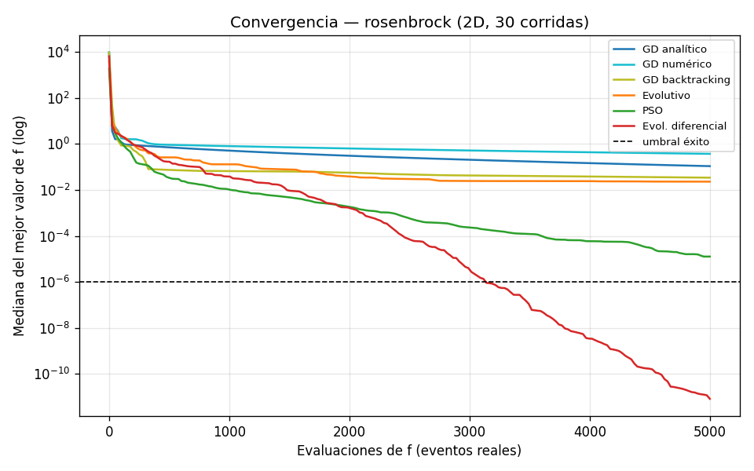

=== "Convergencia Rastrigin 2D"
    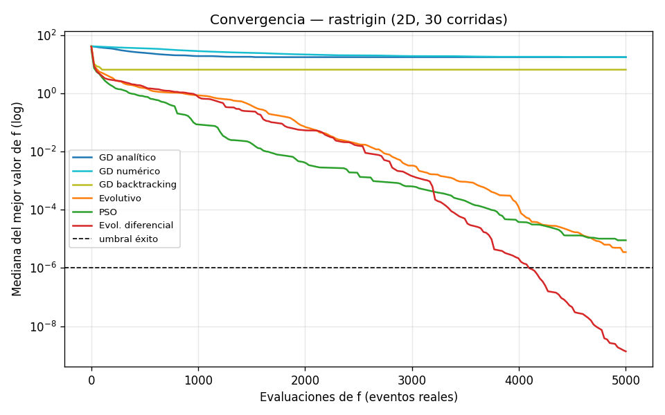

=== "Boxplot Rosenbrock 2D"
    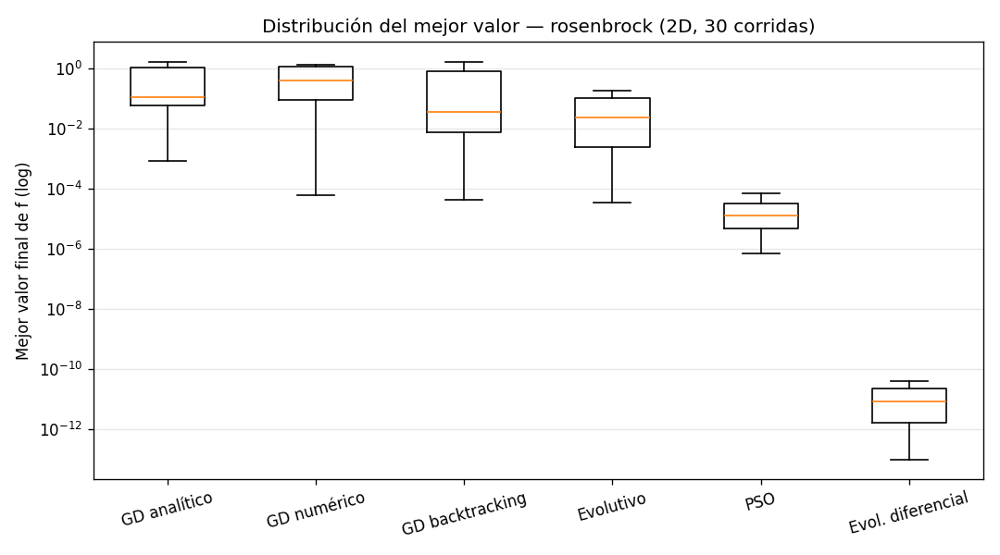

=== "Boxplot Rastrigin 2D"
    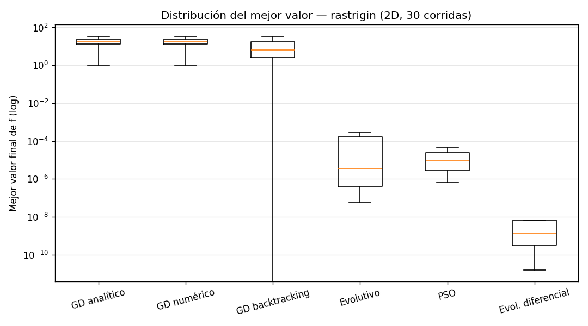

---

## 2. Resultados en Dimensión 3

Al elevar la dimensión a $n=3$, el volumen del espacio se expande exponencialmente y los mínimos locales de Rastrigin crecen a $\approx 1331$.

### 2.1 Tablas Comparativas en 3D

=== "Rosenbrock 3D"
    | Método | Media | Desv. Est. | Mejor | Peor | Mediana | Tasa de Éxito |
    |---|---|---|---|---|---|---|
    | **GD analítico** | 1.172 | 1.732 | 8.05e-03 | 5.668 | 0.194 | 0.0 % (0/30) |
    | **GD numérico** | 1.817 | 1.765 | 6.19e-03 | 6.171 | 1.044 | 0.0 % (0/30) |
    | **GD backtracking** | 0.655 | 1.614 | 3.41e-03 | 6.787 | 0.047 | 0.0 % (0/30) |
    | **Evolutivo** | 0.791 | 1.191 | 8.33e-04 | 5.620 | 0.519 | 0.0 % (0/30) |
    | **PSO** | 0.067 | 0.079 | 1.10e-04 | 0.282 | 0.034 | 0.0 % (0/30) |
    | **Evolución Diferencial** | **3.21e-04** | **5.59e-04** | **8.13e-07** | **2.07e-03** | **7.79e-05** | **3.3 % (1/30)** |

=== "Rastrigin 3D"
    | Método | Media | Desv. Est. | Mejor | Peor | Mediana | Tasa de Éxito |
    |---|---|---|---|---|---|---|
    | **GD analítico** | 27.726 | 15.184 | 4.975 | 65.667 | 25.869 | 0.0 % (0/30) |
    | **GD numérico** | 28.354 | 15.841 | 4.990 | 65.683 | 25.874 | 0.0 % (0/30) |
    | **GD backtracking** | 18.473 | 13.969 | 0.995 | 65.666 | 15.422 | 0.0 % (0/30) |
    | **Evolutivo** | 0.630 | 0.870 | 1.91e-07 | 2.985 | 4.03e-04 | 20.0 % (6/30) |
    | **PSO** | 0.299 | 0.455 | 3.06e-05 | 1.300 | 8.10e-03 | 0.0 % (0/30) |
    | **Evolución Diferencial** | 0.900 | 0.539 | 0.163 | 2.344 | 0.781 | 0.0 % (0/30) |

### 2.2 Gráficos en Dimensión 3

=== "Convergencia Rosenbrock 3D"
    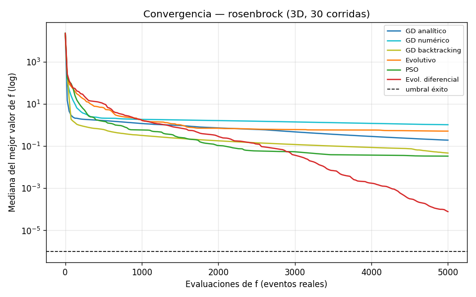

=== "Convergencia Rastrigin 3D"
    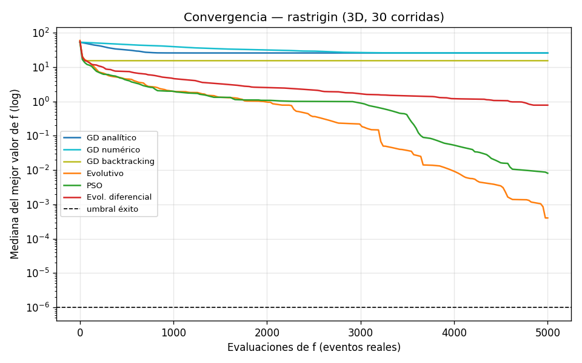

=== "Boxplot Rosenbrock 3D"
    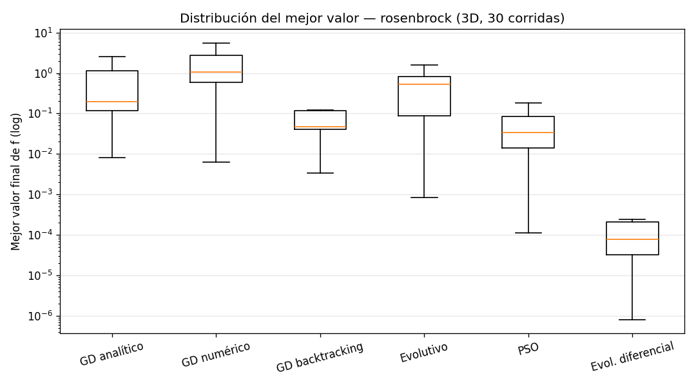

=== "Boxplot Rastrigin 3D"
    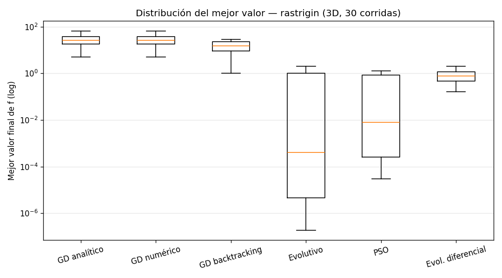

---

## 3. Costo Efectivo Proyectado ($C = n_f + 2n \cdot n_{\nabla f}$)

Al cuantificar el costo real computacional de calcular gradientes, la posición relativa del descenso por gradiente se vuelve aún más desfavorable:

=== "Costo Efectivo 2D"
    | Función | Método | Eval. $f$ (mediana) | Eval. $\nabla f$ (mediana) | Costo Efectivo $C$ (mediana) | Costo Efectivo $C$ (máx.) |
    |---|---|---|---|---|---|
    | **Rosenbrock** | GD analítico | 5000 | 5000 | 25000 | 25000 |
    | **Rosenbrock** | GD numérico | 5000 | 0 | 5000 | 5000 |
    | **Rosenbrock** | GD backtracking | 5000 | 486 | 6946 | 7188 |
    | **Rosenbrock** | Metaheurísticas | 5000 | 0 | 5000 | 5000 |
    | **Rastrigin** | GD analítico | 3178 | 3178 | 15888 | 21516 |
    | **Rastrigin** | GD numérico | 5000 | 0 | 5000 | 5000 |
    | **Rastrigin** | GD backtracking | 276 | 31 | **400** | **523** |
    | **Rastrigin** | Metaheurísticas | 5000 | 0 | 5000 | 5000 |

=== "Gráficas de Costo Efectivo"
    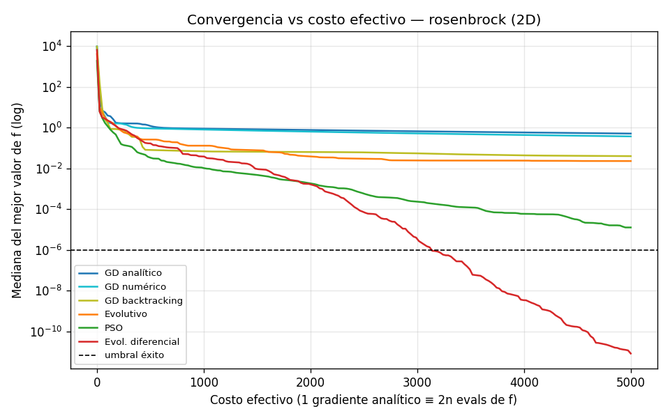
    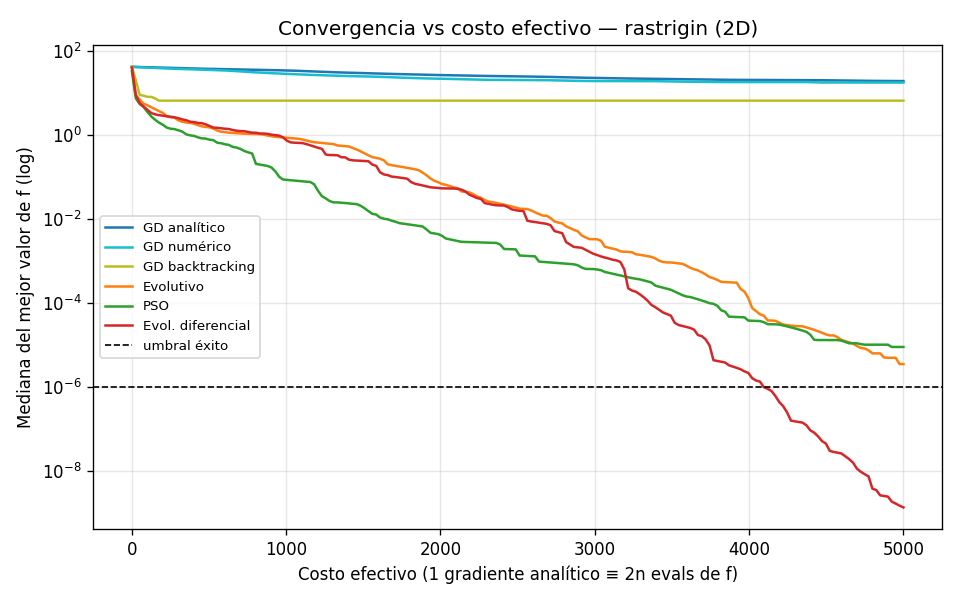

---

## 4. Animaciones de Trayectorias en Rastrigin 2D

Para ilustrar de forma contundente la diferencia entre la búsqueda local unidireccional y la exploración poblacional adaptativa, se generaron las siguientes animaciones sobre el paisaje de Rastrigin:

=== "Descenso por Gradiente (Atrapado en Mínimo Local)"
    

      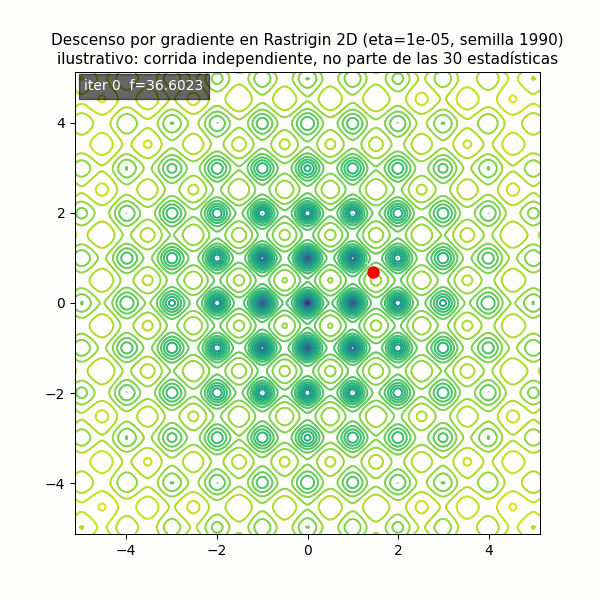
      
<em>El gradiente desciende rápidamente por la pendiente más cercana, quedando irremediablemente atrapado en el primer mínimo local.</em>

    

=== "Evolución Diferencial (Convergencia al Óptimo Global)"
    

      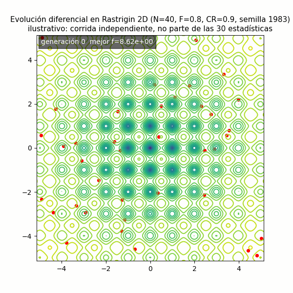
      
<em>La población de vectores de prueba explora múltiples cuencas concurrentemente y colapsa de forma homogénea sobre el origen (0, 0).</em>

    

---

## 5. Síntesis y Conclusiones de la Parte 1

1. **Evolución Diferencial (DE) domina en 2D:** Logró 100% de tasa de éxito en ambas funciones con precisiones de $10^{-10}$ a $10^{-8}$.
2. **Dependencia crítica de las condiciones iniciales en GD:** En Rastrigin el GD de paso fijo tiene 0% de éxito, pues su destino lo sella la cuenca inicial.
3. **El mito del gradiente barato:** Al computar $C = n_f + 2n \cdot n_{\nabla f}$, el GD analítico consume hasta 5 veces más costo que las metaheurísticas sin lograr mejor precisión en paisajes curvos o multimodales.
