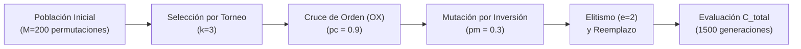

# Algoritmos Genéticos (Genetic Algorithms - AG)

En paralelo a la colonia de hormigas, se implementó un **algoritmo genético generacional con representación por permutaciones** diseñado específicamente para problemas de enrutamiento combinatorio asimétrico.

---

## 1. Arquitectura y Operadores Genéticos

### 1.1 Representación Cromosómica
Cada individuo es una permutación directa $\pi = (\pi_1, \dots, \pi_{47})$ de las 47 capitales de provincia. Esta representación garantiza de forma intrínseca que cada ciudad se visite exactamente una vez.

### 1.2 Selección por Torneo ($k = 3$)
Se seleccionan al azar $k = 3$ individuos con reemplazo, resultando ganador el de menor costo total acumulado. Para una población de $M = 200$, la probabilidad de victoria para el mejor individuo es de $\approx 1{,}5\%$ y para el peor de $\approx 10^{-7}$, manteniendo un balance óptimo entre presión selectiva y diversidad.

### 1.3 Cruce de Orden (Order Crossover - OX)
Con probabilidad $p_c = 0{,}90$:
1. Se seleccionan dos puntos de corte aleatorios $a < b$.
2. El hijo copia directamente el segmento $[a, b]$ del primer progenitor.
3. Las posiciones restantes se completan respetando el orden relativo en que aparecen en el segundo progenitor.

| Individuo | 0 | 1 | 2 | 3 | 4 | 5 | 6 | 7 |
|---|:---:|:---:|:---:|:---:|:---:|:---:|:---:|:---:|
| **Padre 1** | 0 | 1 | **2** | **3** | **4** | 5 | 6 | 7 |
| **Padre 2** | 4 | 7 | 1 | 0 | 6 | 2 | 5 | 3 |
| **Hijo** | 0 | 6 | **2** | **3** | **4** | 5 | 7 | 1 |

!!! tip "Preservación del sentido en TSP asimétrico"
    A diferencia del cruce en un punto (que generaría ciudades repetidas y nulas), OX garantiza rutas válidas y preserva el sentido relativo del recorrido, crítico para un problema asimétrico.

### 1.4 Mutación por Inversión
Con probabilidad $p_m = 0{,}30$ se invierte el orden del segmento entre dos posiciones aleatorias de la permutación.

### 1.5 Parámetros y Presupuesto
- **Población:** $M = 200$ individuos.
- **Generaciones:** $G = 1500$.
- **Élites:** $e = 2$ mejores individuos que pasan intactos.
- **Evaluaciones Totales:** $n_{\text{eval}} = M + G \cdot (M - e) = 200 + 1500 \times 198 = 297\,200$.
- **Tiempo de Ejecución:** $\approx 13{,}8$ s en CPU.

---

## 2. Resultados Obtenidos por Algoritmo Genético

Con la semilla base 1983, el algoritmo genético alcanzó un costo global óptimo de **1.421,04 €**.

  
  
<em>Ruta óptima final generada por el Algoritmo Genético sobre la península ibérica (1.421,04 €).</em>

### 2.1 Desglose Financiero del Circuito
El costo total se descompone de la siguiente manera:

| Componente | Detalle Logístico | Costo (€) | Participación |
|---|---|---:|---:|
| **Tiempo del Conductor** | $91{,}36$ h a $8{,}90$ €/h | **813.10 €** | **57.2 %** |
| **Combustible** | $6\,797{,}72$ km | **570.91 €** | **40.2 %** |
| **Peajes** | 4 tramos seleccionados | **37.03 €** | **2.6 %** |
| **TOTAL** | **Circuito cerrado de 47 capitales** | **1,421.04 €** | **100.0 %** |

### 2.2 Dinámica de Convergencia a lo largo de 1500 Generaciones

| Generación | Evaluaciones Acumuladas | Mejor Costo (€) | Costo Medio Poblacional (€) |
|---:|---:|---:|---:|
| 0 | 200 | 3 846,45 | 4 710,61 |
| 50 | 10 100 | 2 208,68 | 2 581,40 |
| 100 | 20 000 | 1 975,08 | 2 421,47 |
| 250 | 49 700 | 1 609,82 | 2 011,12 |
| 500 | 99 200 | 1 426,98 | 1 590,40 |
| 1000 | 198 200 | 1 421,35 | 1 504,21 |
| **1500** | **297 200** | **1 421,04** | **1 499,69** |

!!! note "Curva de aprendizaje"
    El algoritmo redujo un **63% del costo inicial** de la población aleatoria. El **90% de la reducción total se alcanzó en la generación 209** y el **99% en la generación 477**. Al final, la población retuvo una diversidad del 5,5% respecto al óptimo, evitando el colapso genético total.
