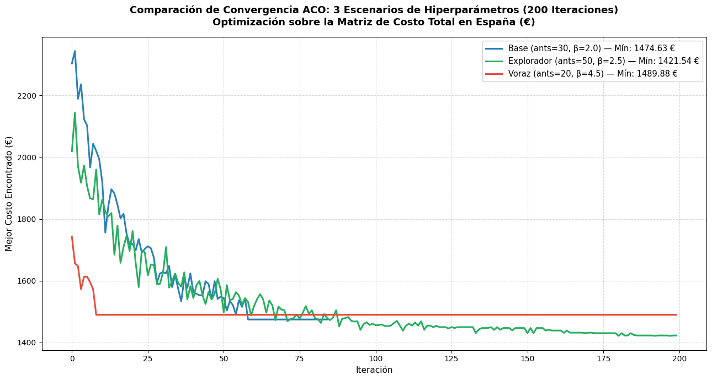

# Colonia de Hormigas (Ant Colony Optimization - ACO)

La optimización por colonia de hormigas es una metaheurística bioinspirada basada en el comportamiento colectivo de búsqueda de alimento observado en colonias de hormigas reales, mediante la comunicación indirecta estigmérgica por rastros químicos (feromonas).

---

## 1. Formulación Matemática de ACO para el TSP

En cada ciclo del algoritmo, una colonia de $m$ hormigas construye de forma concurrente un recorrido cerrado sobre las 47 capitales.

### 1.1 Regla de Transición Probabilística
Ubicada en la ciudad $i$, la hormiga $k$ elige desplazarse a la ciudad $j$ perteneciente a las ciudades aún no visitadas en su memoria tabú $\mathcal{N}_i^k$:

$$p_{ij}^k = \frac{[\tau_{ij}]^{\alpha} \cdot [\eta_{ij}]^{\beta}}{\sum_{l \in \mathcal{N}_i^k} [\tau_{il}]^{\alpha} \cdot [\eta_{il}]^{\beta}}, \quad \forall j \in \mathcal{N}_i^k$$

1. $\tau_{ij}$: Concentración de feromona en la arista $(i,j)$ (memoria histórica colectiva).
2. $\eta_{ij}$: Visibilidad heurística a priori, definida como el inverso multiplicativo del costo financiero:
   
   $$\eta_{ij} = \frac{1}{C_{total}(i,j)}$$
   
3. $\alpha \ge 0$: Sensibilidad a la feromona (intensificación).
4. $\beta \ge 1$: Sensibilidad a la heurística económica (voracidad local).

### 1.2 Regla Pseudo-Aleatoria Proporcional (ACS)
Para balancear exploración y explotación, se introduce el parámetro $q_0 \in [0, 1]$:

$$j = \begin{cases} \arg\max_{l \in \mathcal{N}_i^k} \{[\tau_{il}]^{\alpha} \cdot [\eta_{il}]^{\beta}\}, & \text{si } q \le q_0 \\ J \sim p_{ij}^k, & \text{si } q > q_0 \end{cases}$$

donde $q \sim U(0,1)$ es un número aleatorio uniforme.

### 1.3 Evaporación y Refuerzo de Feromonas
Al finalizar cada generación:
- **Evaporación:** Previene la saturación prematura y el estancamiento:
  
  $$\tau_{ij} \leftarrow (1 - \rho) \cdot \tau_{ij}, \quad \forall (i,j)$$
  
- **Depósito Elitista Global:** Refuerza la mejor ruta encontrada hasta el momento:
  
  $$\tau_{ij} \leftarrow \tau_{ij} + \frac{Q}{L_{\text{mejor}}}, \quad \forall (i,j) \in \pi_{\text{mejor}}$$

---

## 2. Diseño Experimental: Análisis de Sensibilidad en Tres Escenarios

Se diseñaron tres configuraciones operacionales con filosofías de búsqueda contrastantes:

| Hiperparámetro | Escenario Base | Escenario Voraz | Escenario Explorador (Óptimo) |
|---|:---:|:---:|:---:|
| **Número de Hormigas ($m$)** | 30 | 20 | **50** |
| **Tasa de Evaporación ($\rho$)** | 0.10 (10%) | 0.20 (20%, rápida) | **0.05 (5%, lenta)** |
| **Constante de Intensificación ($Q$)** | 2.0 | 3.0 | **1.5** |
| **Sensibilidad a Feromona ($\alpha$)** | 1.0 | 1.5 | **1.0** |
| **Sensibilidad Heurística ($\beta$)** | 2.0 | 4.5 (muy voraz) | **2.5** |
| **Selección Determinista ($q_0$)** | 0.10 | 0.25 | **0.05 (95% estocástica)** |
| **Criterio de Parada** | Early stopping (20 it.) | 200 iteraciones | 200 iteraciones |

---

## 3. Resultados y Comparativa de Convergencia

  
  
<em>Curvas comparativas de convergencia del costo total (€) para los tres escenarios de ACO a lo largo de 200 iteraciones.</em>

| Métrica de Desempeño | Caso Base | Caso Voraz | Caso Explorador (Óptimo) |
|---|:---:|:---:|:---:|
| **Mejor Costo Económico Total** | 1,474.63 € | 1,489.88 € | **1,421.54 €** |
| **Diferencia vs Óptimo** | + 53.09 € (+ 3.73%) | + 68.34 € (+ 4.81%) | **0.00 € (Mínimo Global)** |
| **Tiempo de Cómputo** | 4.7 s | 6.3 s | 18.1 s |
| **Condición de Parada** | Parada temprana (it. 34) | 200 iteraciones | 200 iteraciones |
| **Diagnóstico** | Atrapado en óptimo local prematuro. | Caída inicial rápida pero víctima de **miopía heurística**. | **Búsqueda global sostenida** con desenredo total. |

!!! warning "El peligro de la miopía voraz"
    El Escenario Voraz cae drásticamente en las primeras 5 iteraciones hacia los 1.520 €. Sin embargo, debido a su elevado $\beta = 4{,}5$, las hormigas escogen enlaces individualmente baratos a corto plazo, viéndose obligadas hacia el final del ciclo a dar saltos largos y costosos para cerrar el recorrido con múltiples cruces espaciales.
