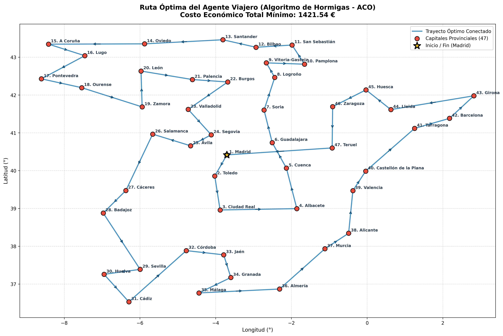
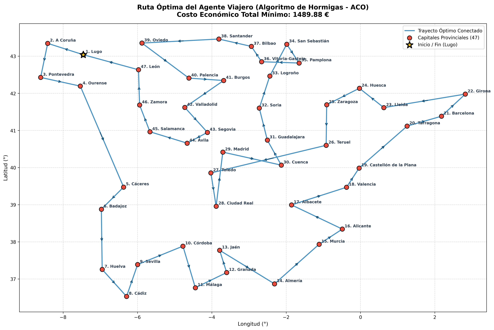
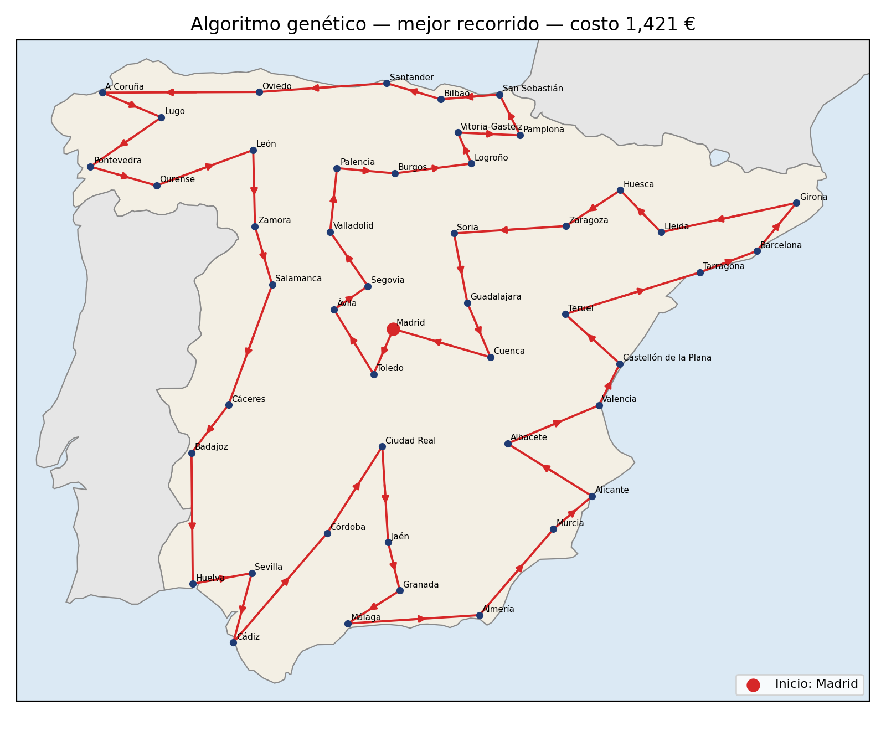
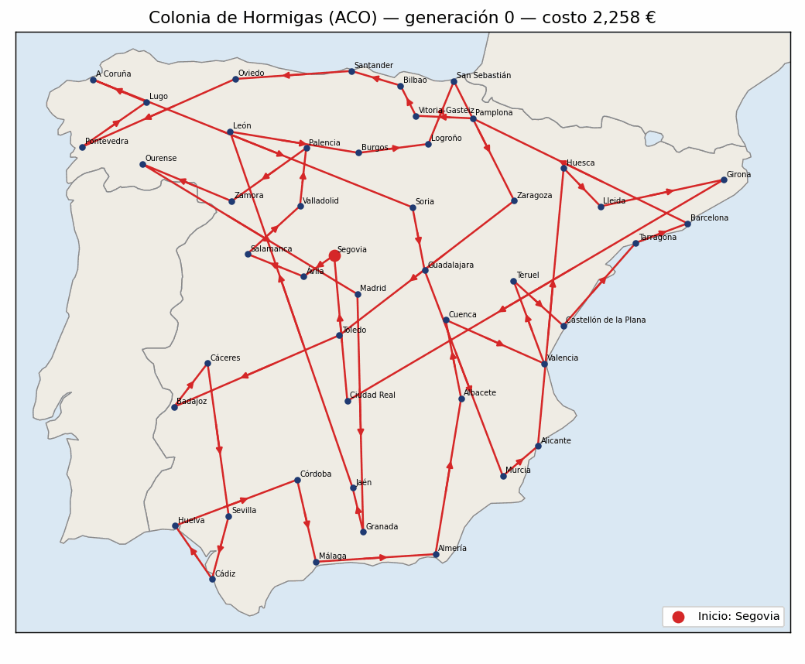
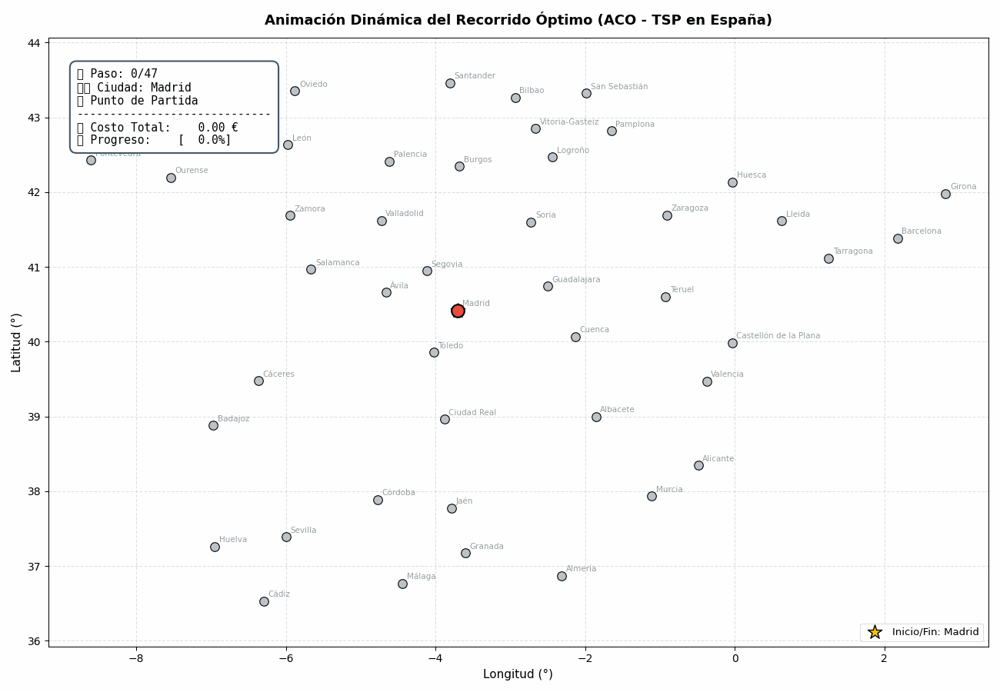

# Comparativa de Rutas, Auditoría Tramo a Tramo y Animaciones

El análisis comparativo entre la **Colonia de Hormigas (ACO - Escenario Explorador)** y los **Algoritmos Genéticos (AG)** arrojó una coincidencia topológica y económica excepcional.

---

## 1. Síntesis Comparativa Global

| Criterio | Colonia de Hormigas (Explorador) | Algoritmo Genético (AG) | Diferencia |
|---|:---:|:---:|:---:|
| **Mejor Costo Total** | **1,421.54 €** | **1,421.04 €** | **0.50 € (0.04%)** |
| **Tiempo de Cómputo** | 18.1 s | 13.8 s | 4.3 s a favor de AG |
| **Evaluaciones de la Función** | $\approx 10\,000$ evaluaciones | $297\,200$ evaluaciones | ACO requirió menos evaluaciones |
| **Topología del Circuito** | Periférica continua, sin auto-intersecciones | Periférica continua, sin auto-intersecciones | Idéntica coherencia macro-espacial |

Ambos algoritmos, partiendo de paradigmas bioinspirados totalmente independientes, convergieron a soluciones prácticamente idénticas dentro de un espacio colosal de $(47-1)! = 46! \approx 5{,}5 \times 10^{57}$ soluciones factibles.

---

## 2. Auditoría Tramo a Tramo del Circuito Óptimo (ACO Explorador)

A continuación se presenta la auditoría pormenorizada de los 47 tramos que componen el recorrido óptimo generado por el Escenario Explorador (Costo Total: **1.421,54 €**):

| Paso | Ciudad Origen | Ciudad Destino | Costo Tramo (€) | Costo Acumulado (€) |
|---:|---|---|---:|---:|
| 1 | Madrid | Toledo | 24.74 € | 24.74 € |
| 2 | Toledo | Ciudad Real | 26.93 € | 51.67 € |
| 3 | Ciudad Real | Albacete | 39.50 € | 91.17 € |
| 4 | Albacete | Cuenca | 32.07 € | 123.24 € |
| 5 | Cuenca | Guadalajara | 32.28 € | 155.52 € |
| 6 | Guadalajara | Soria | 34.26 € | 189.78 € |
| 7 | Soria | Logroño | 29.84 € | 219.62 € |
| 8 | Logroño | Vitoria-Gasteiz | 23.19 € | 242.81 € |
| 9 | Vitoria-Gasteiz | Pamplona | 18.53 € | 261.34 € |
| 10 | Pamplona | San Sebastián | 16.66 € | 278.00 € |
| 11 | San Sebastián | Bilbao | 19.95 € | 297.95 € |
| 12 | Bilbao | Santander | 19.98 € | 317.93 € |
| 13 | Santander | Oviedo | 36.80 € | 354.73 € |
| 14 | Oviedo | A Coruña | 51.68 € | 406.41 € |
| 15 | A Coruña | Lugo | 19.76 € | 426.17 € |
| 16 | Lugo | Pontevedra | 32.58 € | 458.75 € |
| 17 | Pontevedra | Ourense | 33.86 € | 492.61 € |
| 18 | Ourense | Zamora | 52.12 € | 544.73 € |
| 19 | Zamora | León | 38.58 € | 583.31 € |
| 20 | León | Palencia | 35.33 € | 618.64 € |
| 21 | Palencia | Burgos | 17.57 € | 636.21 € |
| 22 | Burgos | Valladolid | 24.18 € | 660.39 € |
| 23 | Valladolid | Segovia | 21.68 € | 682.07 € |
| 24 | Segovia | Ávila | 23.22 € | 705.29 € |
| 25 | Ávila | Salamanca | 21.58 € | 726.87 € |
| 26 | Salamanca | Cáceres | 37.87 € | 764.74 € |
| 27 | Cáceres | Badajoz | 19.91 € | 784.65 € |
| 28 | Badajoz | Sevilla | 40.67 € | 825.32 € |
| 29 | Sevilla | Huelva | 17.34 € | 842.66 € |
| 30 | Huelva | Cádiz | 39.40 € | 882.06 € |
| 31 | Cádiz | Córdoba | 47.64 € | 929.70 € |
| 32 | Córdoba | Jaén | 22.96 € | 952.66 € |
| 33 | Jaén | Granada | 17.80 € | 970.46 € |
| 34 | Granada | Málaga | 26.80 € | 997.26 € |
| 35 | Málaga | Almería | 42.55 € | 1039.81 € |
| 36 | Almería | Murcia | 38.24 € | 1078.05 € |
| 37 | Murcia | Alicante | 28.89 € | 1106.94 € |
| 38 | Alicante | Valencia | 32.84 € | 1139.78 € |
| 39 | Valencia | Castellón de la Plana | 15.44 € | 1155.22 € |
| 40 | Castellón de la Plana | Tarragona | 34.84 € | 1190.06 € |
| 41 | Tarragona | Barcelona | 19.78 € | 1209.84 € |
| 42 | Barcelona | Girona | 20.05 € | 1229.89 € |
| 43 | Girona | Lleida | 42.29 € | 1272.18 € |
| 44 | Lleida | Huesca | 18.57 € | 1290.75 € |
| 45 | Huesca | Zaragoza | 23.12 € | 1313.87 € |
| 46 | Zaragoza | Teruel | 41.18 € | 1355.05 € |
| 47 | Teruel | Madrid | 66.49 € | 1421.54 € |

---

## 3. Cartografía Comparativa

=== "Circuito Óptimo (ACO Explorador: 1.421,54 €)"
    

=== "Circuito Subóptimo (ACO Voraz: 1.489,88 €)"
    
    *Nótese cómo el enfoque voraz genera cruces y saltos diagonales ineficientes.*

=== "Circuito Óptimo (Algoritmo Genético: 1.421,04 €)"
    

---

## 4. Animaciones Dinámicas de Aprendizaje y Enrutamiento

Para observar la dinámica viva de los algoritmos se generaron animaciones completas:

=== "Desenredo de la Red Vial (Evolución por Generaciones)"
    

      
      
<em>Evolución generacional de las rutas: se observa claramente cómo la colonia de hormigas elimina auto-intersecciones hasta consolidar el circuito periférico óptimo.</em>

    

=== "Recorrido Comercial Dinámico Tramo a Tramo"
    

      
      
<em>Simulación vehicular tramo a tramo con monitoreo en tiempo real del costo acumulado (€) y porcentaje de avance sobre las 47 capitales.</em>

    

