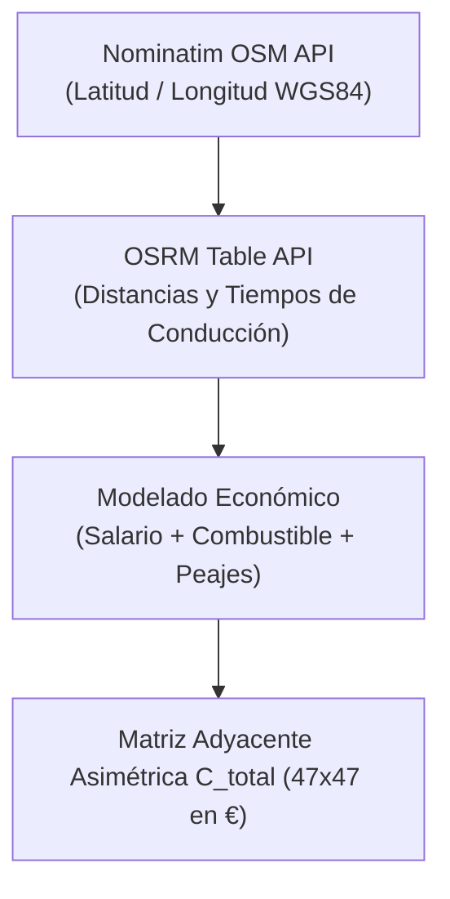
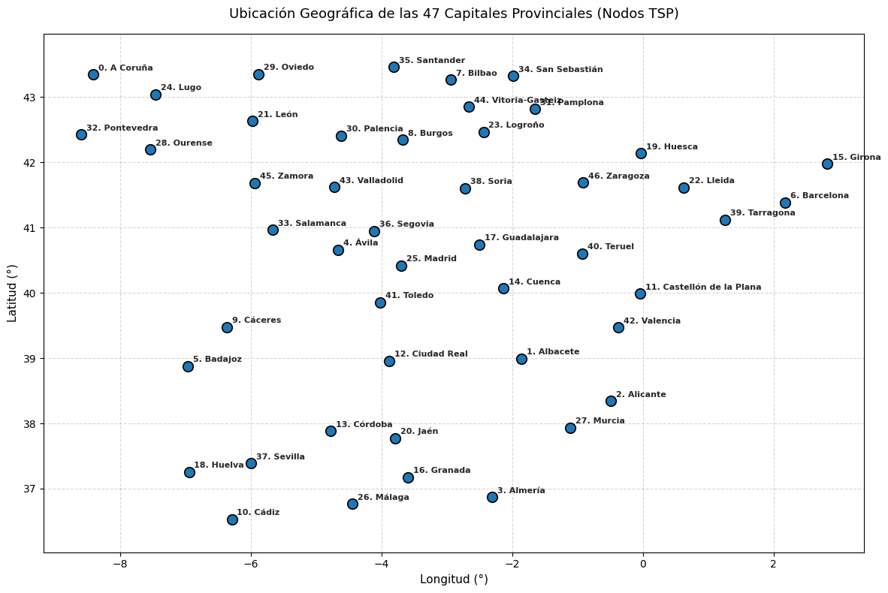
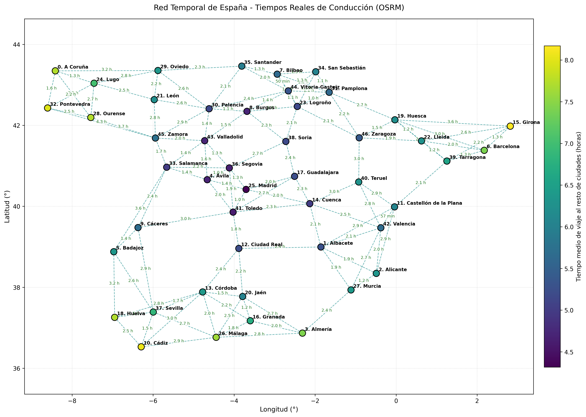
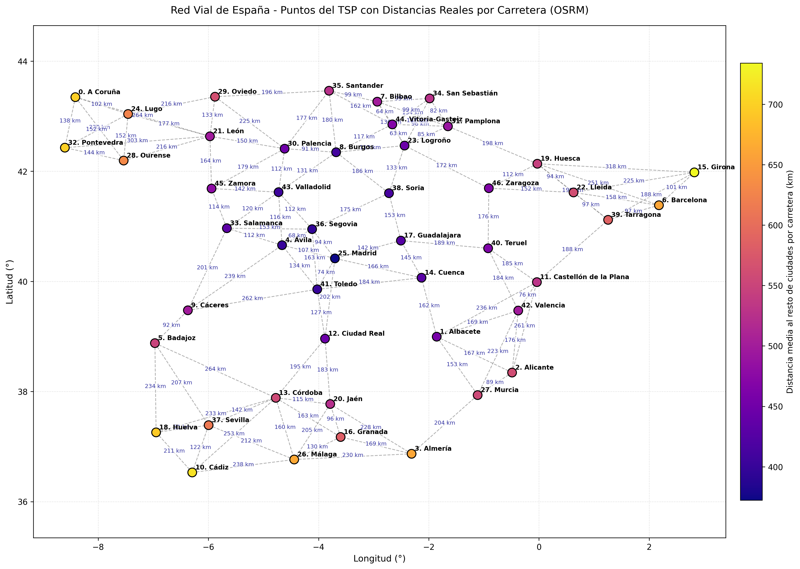

# Modelado Logístico Real y Adquisición de Datos Viales

En la segunda parte del proyecto se aborda un problema de optimización combinatoria a escala real: el **Problema del Viajero (TSP) asimétrico** sobre las **47 capitales de provincia de la España peninsular**, partiendo de y regresando a la capital nacional (Madrid).

---

## 1. Delimitación Territorial y Geocodificación

### 1.1 Cobertura Territorial Continua
Se delimitaron estrictamente las 47 capitales provinciales situadas en la España peninsular. Se excluyeron los territorios insulares (Islas Baleares e Islas Canarias) y las ciudades autónomas en el norte de África (Ceuta y Melilla) para preservar una **red física y continua de transporte carretero terrestre**, evitando la introducción de transporte multimodal marítimo o aéreo.

### 1.2 Geocodificación con OpenStreetMap (OSM)
Mediante el servicio Nominatim y la biblioteca `geopy`, se obtuvieron las coordenadas espaciales exactas en grados decimales (elipsoide WGS84). Se aplicó una política de control de frecuencia estricto (*rate limiting*) con pausas obligatorias de $\Delta t = 1{,}1$ s para garantizar la integridad de las consultas.

  
  
<em>Distribución geográfica de las 47 capitales provinciales de la España peninsular.</em>

---

## 2. Red Vial y Tiempos de Conducción (OSRM)

Para evitar aproximaciones euclidianas irreales en problemas de transporte carretero, se consultó el endpoint `/table/v1/driving/` de **Open Source Routing Machine (OSRM)** sobre la red vial real de OpenStreetMap.

El perfil vehicular `car.lua` incorpora de forma nativa:
- La jerarquía funcional de la red española: autovías y autopistas a 110–120 km/h, vías convencionales a 90 km/h y tramos urbanos a 30–50 km/h.
- Penalizaciones por giros, glorietas y cruces semafóricos (*turn penalties* de 2 a 5 segundos).

=== "Grafo de Tiempos de Conducción"
    

=== "Grafo de Distancias en Carretera"
    

### 2.1 Análisis de Velocidades Medias Efectivas
Relacionando la distancia $d_{ij}$ y el tiempo $t_{ij}$, se calculó la velocidad media comercial puerta a puerta para los 2.162 trayectos interprovinciales:

| Métrica Estadística | Valor Calculado | Interpretación Logística y Territorial |
|---|---:|---|
| **Velocidad Promedio Nacional** | **85.35 km/h** | Velocidad comercial real considerando la penetración urbana. |
| **Mediana** | **87.36 km/h** | El 50% de las rutas superan los 87.36 km/h de velocidad de crucero. |
| **Desviación Estándar** | **6.79 km/h** | Refleja alta madurez y homogeneidad en la red de autovías del Estado. |
| **Velocidad Mínima** | **48.23 km/h** | Teruel ↔ Guadalajara (orografía montañosa y carreteras convencionales). |
| **Velocidad Máxima** | **96.84 km/h** | San Sebastián ↔ Girona (corredor continuo 100% de autopista). |

---

## 3. Modelo de Costo Económico Total ($C_{total}$)

La función objetivo del TSP refleja la contabilidad real de una empresa de transporte logístico. Cada tramo $(i, j)$ integra tres componentes:

$$C_{total}(i,j) = v_h \cdot T_{carretera}(i,j) + C_{combustible}(i,j) + C_{peajes}(i,j)$$

### 3.1 Costo de Mano de Obra y Salario ($v_h$)
Se fijó una tasa horaria de **$v_h = 8{,}90$ €/hora** para un conductor profesional, calculada sobre el Salario Mínimo Interprofesional (SMI) vigente más cotizaciones a la Seguridad Social.

### 3.2 Costo de Combustible ($C_{combustible}$)
Se seleccionó como vehículo de referencia un utilitario de distribución masiva: **Dacia Sandero TCe**.
- Consumo mixto oficial WLTP: $4{,}7$ L / 100 km ($0{,}047$ L/km).
- Cotización media oficial de gasolina (MITECO): $1{,}787$ €/L.
- Costo unitario: $C_{km,comb} = 0{,}047 \times 1{,}787 \approx 0{,}083989$ €/km.

$$C_{combustible}(i,j) = d_{carretera}(i,j) \times 0{,}083989\ \text{€}$$

### 3.3 Modelado de Peajes Activos ($C_{peajes}$)
Se identificaron los peajes activos en corredores de alta montaña y accesos metropolitanos (AP-66 Huerna, AP-68 Bilbao-Zaragoza, AP-9 Galicia, AP-15 Navarra, AP-6/61 Guadarrama y tramos de AP-7):

$$C_{peajes}(i,j) = M_{peajes}(i,j) \cdot d_{carretera}(i,j) \cdot 0{,}125\ \text{€/km}$$

### 3.4 Desglose y Ponderación del Gasto Logístico
El cálculo medio para los 2.162 pares de ciudades revela el peso relativo de cada rubro:

| Componente | Gasto Medio (€) | Participación | Impacto en la Optimización |
|---|---:|---:|---|
| **Salario del Conductor** ($8{,}90$ €/h) | 55.27 € | **54.8 %** | **Factor dominante:** prima rutas rápidas sobre rutas cortas. |
| **Combustible** (Dacia Sandero) | 45.29 € | **44.9 %** | Costo directo proporcional al kilometraje recorrido. |
| **Peajes de Autopista** | 0.30 € | **0.3 %** | Costo puntual concentrado en pasos de montaña específicos. |
| **COSTO PROMEDIO POR ENLACE** | **100.86 €** | **100.0 %** | Promedio de conectar dos capitales provinciales en España. |

!!! important "Asimetría de la Red"
    Dado que las pendientes, accesos a autopistas, variantes y sentidos únicos provocan que $C_{ij} \neq C_{ji}$, el problema es un **TSP Asimétrico** donde el sentido del recorrido forma parte esencial de la solución.
