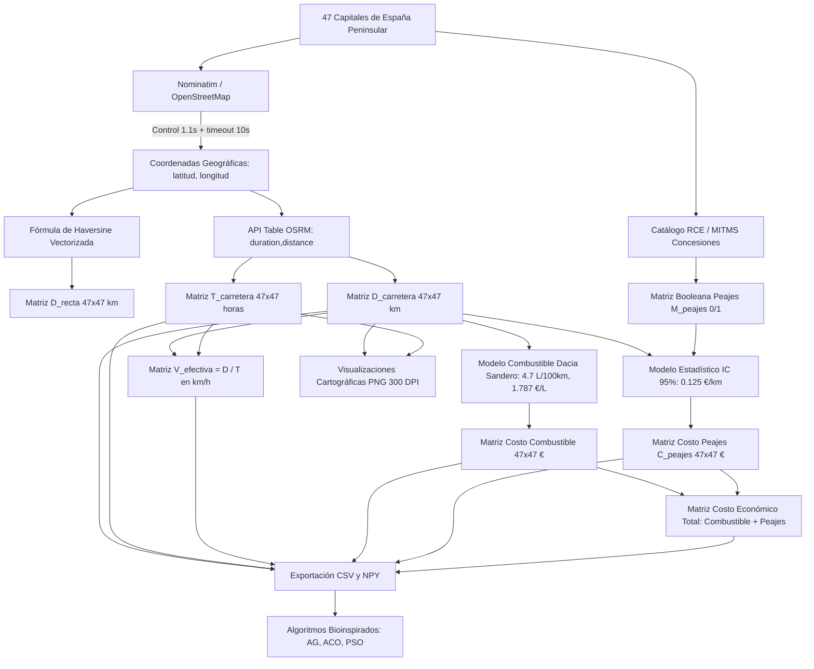

# Documentación Técnica y Metodológica: Construcción de Matrices de Distancias, Tiempos, Velocidades y Costos Económicos para el Problema del Viajero (TSP)

**Asignatura:** Redes Neuronales y Algoritmos Bioinspirados  
**Proyecto:** Trabajo 1 - Parte 2: Problema del Agente Viajero (TSP) en las Capitales de España Peninsular  
**Autor:** Gianca  
**Fecha:** Octubre 2026  

---

## Resumen Ejecutivo

El presente documento describe la metodología técnica, formulación física y matemática, modelado estadístico e implementación computacional empleada para la construcción integral de los conjuntos de datos del **Problema del Agente Viajero (TSP - *Traveling Salesperson Problem*)** sobre las 47 capitales de provincia de la España peninsular. 

Se desarrollaron y validaron seis matrices interurbanas de dimensión $47 \times 47$:
1. **Matriz Geodésica ($D_{\text{recta}}$):** Calculada analíticamente mediante la **Fórmula del Semiverseno (*Haversine*)** vectorizada en NumPy sobre la esfera terrestre (en kilómetros).
2. **Matriz Vial Real ($D_{\text{carretera}}$):** Obtenida mediante el motor de enrutamiento **OSRM (*Open Source Routing Machine*)** sobre la infraestructura vial real de OpenStreetMap (en kilómetros).
3. **Matriz Temporal de Conducción ($T_{\text{carretera}}$):** Tiempos reales de viaje en horas, incorporando clasificación de vías, límites legales de velocidad y penalizaciones por intersecciones.
4. **Matriz de Velocidad Media Efectiva ($V_{\text{efectiva}}$):** Relación física entre distancia y tiempo ($D/T$) en km/h, caracterizando la eficiencia de la red vial interprovincial.
5. **Matriz de Costo de Combustible ($C_{\text{combustible}}$):** Modelo de consumo energético para el vehículo **Dacia Sandero** (4.7 L / 100 km) con precio de gasolina oficial en España (1.787 €/L), expresado en euros (€).
6. **Matriz Económica de Peajes ($C_{\text{peajes}}$) y Matriz Booleana ($M_{\text{peajes}}$):** Identificación de autopistas de peaje activas en la Red de Carreteras del Estado y estimación estadística del costo monetario en euros mediante un **Intervalo de Confianza al 95%** de tarifa kilométrica.

Estos datasets permiten formular tanto el TSP mono-objetivo clásico como variantes **multiobjetivo** (distancia vs. tiempo vs. costo monetario integral) y **restringidas** (*toll-free routing*) para algoritmos bioinspirados (Algoritmos Genéticos, Colonias de Hormigas [ACO], Optimización por Enjambre de Partículas [PSO]).

---

## 1. Definición del Problema e Instancia

El Problema del Agente Viajero es un problema clásico de optimización combinatoria clasificado como **NP-Hard**. Dado un conjunto finito de $N = 47$ nodos (ciudades) $V = \{v_1, v_2, \dots, v_N\}$ y una o varias matrices de costos $C = (c_{ij})_{N \times N}$, el objetivo consiste en hallar una permutación cíclica $\pi = (\pi_1, \pi_2, \dots, \pi_N)$ que minimice la función objetivo de costo total de la ruta:

$$\min f(\pi) = \sum_{k=1}^{N-1} c_{\pi_k, \pi_{k+1}} + c_{\pi_N, \pi_1}$$

### Conjunto de Nodos Seleccionados
Se consideraron las 47 capitales provinciales situadas en la península ibérica (excluyendo los territorios insulares de Baleares y Canarias, y las ciudades autónomas de Ceuta y Melilla, con el fin de preservar la conexidad vial continua):

> *A Coruña, Albacete, Alicante, Almería, Ávila, Badajoz, Barcelona, Bilbao, Burgos, Cáceres, Cádiz, Castellón de la Plana, Ciudad Real, Córdoba, Cuenca, Girona, Granada, Guadalajara, Huelva, Huesca, Jaén, León, Lleida, Logroño, Lugo, Madrid, Málaga, Murcia, Ourense, Oviedo, Palencia, Pamplona, Pontevedra, Salamanca, San Sebastián, Santander, Segovia, Sevilla, Soria, Tarragona, Teruel, Toledo, Valencia, Valladolid, Vitoria-Gasteiz, Zamora, Zaragoza.*

---

## 2. Geocodificación y Adquisición de Datos

Para obtener las coordenadas espaciales $(\text{latitud}_i, \text{longitud}_i)$ de cada capital, se implementó un proceso de geocodificación directa mediante el servicio **Nominatim** provisto por la Fundación **OpenStreetMap (OSM)** a través de la librería Python `geopy`.

### Consideraciones Técnicas y Políticas de Uso
1. **Control de Frecuencia (*Rate Limiting*):** La política de uso aceptable de Nominatim (*Usage Policy*) restringe las peticiones automatizadas a un máximo estricto de **1 petición por segundo**. Por este motivo, se incorporó una pausa obligatoria:
   $$\Delta t = 1.1 \text{ segundos}$$
   entre consultas sucesivas, garantizando la estabilidad del servicio y evitando el bloqueo de la dirección IP cliente.
2. **Tolerancia a Latencia (*Timeout*):** Para mitigar fluctuaciones de red o latencia en el servidor público (que derivan en la excepción `GeocoderTimedOut`), se fijó un umbral de tiempo de espera explícito:
   $$\text{timeout} = 10 \text{ s}$$

Las coordenadas resultantes se expresaron en grados decimales:
$$\text{coords}_i = (\phi_i, \lambda_i) \in [-90^\circ, 90^\circ] \times [-180^\circ, 180^\circ]$$

---

## 3. Matriz de Distancias en Línea Recta ($D_{\text{recta}}$)

### 3.1. Fundamento Matemático: Fórmula del Semiverseno (*Haversine*)
La distancia más corta entre dos puntos situados sobre la superficie de una esfera se denomina distancia de círculo máximo (*great-circle distance*). La fórmula del semiverseno evita errores de cancelación numérica para distancias cortas.

Dados dos puntos con latitud y longitud $(\phi_1, \lambda_1)$ y $(\phi_2, \lambda_2)$ convertidos a radianes:
$$\Delta \phi = \phi_2 - \phi_1, \quad \Delta \lambda = \lambda_2 - \lambda_1$$

El semiverseno del ángulo central $\Theta$ se define como:
$$a = \operatorname{hav}(\Theta) = \sin^2\left(\frac{\Delta \phi}{2}\right) + \cos(\phi_1) \cdot \cos(\phi_2) \cdot \sin^2\left(\frac{\Delta \lambda}{2}\right)$$

La distancia angular central $\Theta$ (en radianes) es:
$$\Theta = 2 \cdot \arcsin(\sqrt{a})$$

Multiplicando por el radio medio volumétrico de la Tierra establecido por la IUGG ($R \approx 6371.0\text{ km}$), se obtiene la distancia física:
$$d_{\text{recta}}(i, j) = 2 R \cdot \arcsin\left(\sqrt{\sin^2\left(\frac{\phi_j - \phi_i}{2}\right) + \cos(\phi_i)\cos(\phi_j)\sin^2\left(\frac{\lambda_j - \lambda_i}{2}\right)}\right)$$

### 3.2. Implementación Vectorizada de Alto Rendimiento
Se implementó mediante el mecanismo de **difusión multidimensional (*Broadcasting*)** de NumPy, calculando todas las diferencias cruzadas de forma instantánea en $\mathcal{O}(N^2)$:

```python
coords_rads = np.radians(np.array(coords))
lat = coords_rads[:, 0][:, None]  # Forma (47, 1)
lon = coords_rads[:, 1][:, None]  # Forma (47, 1)

dlat = lat - lat.T
dlon = lon - lon.T

a = np.sin(dlat / 2)**2 + np.cos(lat) * np.cos(lat.T) * np.sin(dlon / 2)**2
D_recta = 2 * 6371.0 * np.arcsin(np.sqrt(a))  # km, simétrica, diagonal en cero
```

---

## 4. Matrices Viales: Distancias ($D_{\text{carretera}}$) y Tiempos ($T_{\text{carretera}}$)

### 4.1. Limitaciones del Modelo Geodésico y Tortuosidad
En el mundo real, los vehículos deben ceñirse a las curvas y la orografía (Cordillera Cantábrica, Sistema Central, Sierra Morena). El **factor de tortuosidad ($\tau$)** mide esta desviación:
$$\tau_{ij} = \frac{d_{\text{carretera}}(i, j)}{d_{\text{recta}}(i, j)} \ge 1.0$$
En España peninsular, $\tau$ oscila típicamente entre $1.20$ y $1.73$.

### 4.2. Consulta Unificada a la API Table de OSRM
Se utilizó el motor **OSRM (*Open Source Routing Machine*)**, basado en jerarquías de contracción (*Contraction Hierarchies*) sobre el grafo de vías de OpenStreetMap. 

Mediante el parámetro `annotations=duration,distance`, se extrajeron ambas métricas en una sola petición HTTP:

```http
GET http://router.project-osrm.org/table/v1/driving/{lon1,lat1;lon2,lat2;...}?annotations=duration,distance
```

* **Conversión de Distancias:** De metros a kilómetros:
  $$D_{\text{carretera}} = \frac{D_{\text{OSRM}}}{1000.0}$$
* **Conversión de Tiempos:** De segundos a horas decimales:
  $$T_{\text{carretera}} = \frac{T_{\text{OSRM}}}{3600.0}$$
* **Configuración de Resiliencia (`timeout=30s`):** Como la consulta evalúa $47 \times 47 = 2.209$ pares de rutas, un timeout preventivo de 30 segundos garantiza que la petición no se cancele por latencia puntual en el servidor público.

### 4.3. Factores Considerados por OSRM para los Tiempos de Viaje
OSRM emplea el perfil `car.lua` basado en etiquetas de OpenStreetMap:
1. **Jerarquía vial:** Autopistas/Autovías (`motorway` $\approx 110-120\text{ km/h}$), Carreteras nacionales (`trunk`/`primary` $\approx 90-100\text{ km/h}$), Carreteras secundarias (`secondary` $\approx 70-80\text{ km/h}$), Calles urbanas ($\approx 30-50\text{ km/h}$).
2. **Límites de velocidad explícitos (`maxspeed`):** Señalización específica por tramo.
3. **Penalizaciones por giros e intersecciones (*Turn Penalties*):** Penalización de 2 a 5 segundos por giro en cruces, más reducciones de velocidad en rotondas y semáforos.

---

## 5. Análisis de Velocidades Medias Efectivas de la Red Vial ($V_{\text{efectiva}}$)

### 5.1. Relación Física
Relacionando la distancia y el tiempo de viaje entre cada par $(i, j)$ se obtiene la velocidad media efectiva en km/h:
$$V_{\text{efectiva}}(i, j) = \frac{d_{\text{carretera}}(i, j)}{t_{\text{carretera}}(i, j)} \quad (\text{para } i \ne j)$$

### 5.2. Resultados Estadísticos Observados en España
Procesando los 2.162 enlaces interurbanos del país:

| Métrica Estadística | Valor Calculado | Descripción Territorial |
| :--- | :---: | :--- |
| **Velocidad Promedio Global ($\bar{V}$)** | **85.35 km/h** | Velocidad comercial real interprovincial puerta a puerta. |
| **Mediana** | **87.36 km/h** | El 50% de las conexiones superan los 87 km/h. |
| **Desviación Estándar ($\sigma$)** | **6.79 km/h** | Alta homogeneidad de la red de gran capacidad española. |
| **Velocidad Mínima** | **48.23 km/h** | **Teruel $\leftrightarrow$ Guadalajara** (orografía abrupta por carretera convencional). |
| **Velocidad Máxima** | **96.84 km/h** | **San Sebastián $\leftrightarrow$ Girona** (corredor norte 100% autovía continua). |

### 5.3. Fundamento en Ingeniería de Transporte
El promedio nacional de **~85.35 km/h** refleja la realidad de que todo viaje entre capitales incluye tramos urbanos a baja velocidad (30–50 km/h) con semáforos y rotondas al salir y entrar a las ciudades, lo cual reduce la velocidad promedio respecto al límite de crucero de 120 km/h de las autovías.

---

## 6. Modelo de Costo de Combustible (Renault / Dacia Sandero)

### 6.1. Parámetros del Vehículo y Combustible
Para modelar el consumo energético real del agente viajero, se seleccionó uno de los vehículos utilitarios más vendidos en el mercado español: el **Dacia Sandero** (Grupo Renault):

* **Vehículo:** Dacia Sandero (Motor Gasolina TCe).
* **Consumo Mixto Homologado (WLTP):** $C_{\text{tasa}} = 4.7\text{ L} / 100\text{ km} = 0.047\text{ L/km}$.
* **Precio Medio de Gasolina en España (2026):** $P_{\text{comb}} = 1.787\text{ €/L}$ *(Fuente: Geoportal de Gasolineras del MITECO)*.

### 6.2. Costo Unitario y Matriz de Combustible ($C_{\text{combustible}}$)
El costo unitario de combustible por kilómetro recorrido es:
$$C_{\text{km, comb}} = \left(\frac{4.7\text{ L}}{100\text{ km}}\right) \times 1.787\text{ €/L} = 0.047 \times 1.787 \approx \mathbf{0.08399\text{ €/km}} \quad (\approx 8.4\text{ céntimos de euro/km})$$

La matriz de costo económico de combustible (en euros) entre cada par $(i, j)$ se calcula vectorialmente como:
$$C_{\text{combustible}}(i, j) = d_{\text{carretera}}(i, j) \times C_{\text{km, comb}}$$

* **Diagonal:** $C_{\text{combustible}}(i, i) = 0.0\text{ €}$.
* **Rango:** Desde **~5.29 €** (conexiones cortas como Palencia–Valladolid, 62.9 km) hasta **~101.83 €** (conexiones de extremo a extremo como Girona–Pontevedra, 1.212 km).

---

## 7. Modelado y Estimación de Peajes en España

### 7.1. Contexto Histórico y Normativo de la Red de Peajes
Históricamente, España contaba con un número elevado de autopistas de peaje. Entre **2018 y 2021**, el Gobierno de España aplicó una política de no prórroga de concesiones, liberando autopistas icónicas:
* **Liberadas (Gratuitas):** AP-1 (Burgos–Armiñón), AP-4 (Sevilla–Cádiz), AP-2 (Zaragoza–Mediterráneo) y AP-7 (Tarragona–Alicante y Cataluña).
* **Peajes Activos Relevantes:** Concesiones vigentes a largo plazo como la **AP-66** del Huerna (Asturias–León, hasta 2050), la **AP-68** (Bilbao–Zaragoza, hasta 2026), la **AP-9** (Eje Atlántico Gallego), la **AP-15** (Navarra), la **AP-6/51/61** (Túneles de Guadarrama hacia Segovia y Ávila), la **AP-41** (Madrid–Toledo) y tramos de la **AP-7** en Costa del Sol y Alicante.

### 7.2. Matriz Booleana de Peajes ($M_{\text{peajes}}$)
Se construyó una matriz simétrica binaria $M_{\text{peajes}} \in \{0, 1\}^{47 \times 47}$ donde:
$$M_{\text{peajes}}(i, j) = \begin{cases} 1, & \text{si el corredor principal entre } i \text{ y } j \text{ contiene autopista de peaje} \\ 0, & \text{en caso contrario (autovía gratuita o carretera convencional)} \end{cases}$$

### 7.3. Estimación Estadística de la Tarifa Kilométrica (€/km)
Analizando las tarifas oficiales de las concesionarias (*Abertis, Itínere, Ausol, Aucalsa*) aprobadas por el Ministerio de Transportes para vehículos ligeros (turismos) en una muestra de $n = 11$ corredores activos:

* **Media muestral ($\bar{x}$):** $0.125\text{ €/km}$ (12.5 céntimos de euro por kilómetro).
* **Desviación estándar ($s$):** $0.021\text{ €/km}$.
* **Error estándar ($SE$):** $0.0063\text{ €/km}$.

Aplicando la distribución $t$-Student con $n - 1 = 10$ grados de libertad ($t_{0.025} = 2.228$):
$$\text{IC}_{95\%} = \bar{x} \pm t \cdot \frac{s}{\sqrt{n}} = 0.125 \pm 0.014$$

$$\mathbf{IC}_{95\%} = [\mathbf{0.111\text{ €/km}}, \quad \mathbf{0.139\text{ €/km}}]$$

### 7.4. Matriz Económica de Costo de Peajes ($C_{\text{peajes}}$)
El costo estimado en euros se obtiene mediante el producto matricial de Hadamard:
$$C_{\text{peajes}}(i, j) = M_{\text{peajes}}(i, j) \cdot d_{\text{carretera}}(i, j) \cdot \bar{t}_{\text{km}}$$

### 7.5. Tabla Consolidada de Tramos con Peaje Identificados
Filtrando los pares simétricos ($i < j$), se genera la tabla de referencia para reportes:

| Ciudad Origen | Ciudad Destino | Distancia (km) | Costo Estimado (€) | IC 95% Mín (€) | IC 95% Máx (€) |
| :--- | :--- | :---: | :---: | :---: | :---: |
| **Cádiz** | **Málaga** | 238.7 | **29.84 €** | 26.50 € | 33.18 € |
| **Pamplona** | **Zaragoza** | 181.7 | **22.71 €** | 20.17 € | 25.26 € |
| **Logroño** | **Zaragoza** | 173.6 | **21.70 €** | 19.27 € | 24.13 € |
| **Guadalajara**| **Madrid** | 143.0 | **17.87 €** | 15.87 € | 19.88 € |
| **A Coruña** | **Pontevedra** | 137.4 | **17.17 €** | 15.25 € | 19.09 € |
| **Bilbao** | **Logroño** | 136.9 | **17.11 €** | 15.20 € | 19.03 € |
| **León** | **Oviedo** | 133.4 | **16.67 €** | 14.81 € | 18.54 € |
| **Madrid** | **Segovia** | 94.4 | **11.80 €** | 10.48 € | 13.12 € |
| **Alicante** | **Murcia** | 89.2 | **11.14 €** | 9.90 € | 12.39 € |
| **Madrid** | **Toledo** | 74.8 | **9.23 €** | 8.30 € | 10.40 € |

---

## 8. Formulación Integral para Algoritmos Bioinspirados

Con estos datasets, los algoritmos bioinspirados pueden evaluar diversos escenarios de optimización:

### Escenario A: TSP Mono-Objetivo Clásico (Distancia o Tiempo)
Minimizar exclusivamente el kilometraje total o el tiempo de jornada laboral:
$$f_{\text{dist}}(\pi) = \sum_{k=1}^{N} d_{\text{carretera}}(\pi_k, \pi_{k+1}), \qquad f_{\text{tiempo}}(\pi) = \sum_{k=1}^{N} t_{\text{carretera}}(\pi_k, \pi_{k+1})$$

### Escenario B: TSP Económico Integral (Combustible + Peajes)
Minimizar el gasto financiero total del viaje:
$$f_{\text{económico}}(\pi) = \sum_{k=1}^{N} \left( C_{\text{combustible}}(\pi_k, \pi_{k+1}) + C_{\text{peajes}}(\pi_k, \pi_{k+1}) \right)$$

### Escenario C: TSP Multiobjetivo Ponderado
Minimizar una función de costo logístico integral combinando tiempo y presupuesto:
$$f_{\text{multi}}(\pi) = w_1 \cdot T(\pi) + w_2 \cdot C_{\text{económico}}(\pi)$$

### Escenario D: TSP Restringido sin Peajes (*Toll-Free TSP*)
Penalización infinita en la función de aptitud (*fitness*) para rutas que incluyan peajes:
$$\text{Fitness}(\pi) = f_{\text{dist}}(\pi) + \infty \cdot \sum_{k=1}^{N} M_{\text{peajes}}(\pi_k, \pi_{k+1})$$

---

## 9. Visualización Cartográfica y Análisis de Conectividad

Se diseñaron dos módulos de visualización gráfica en alta resolución (300 DPI):

1. **Red Vial por Distancia (`red_vial_espana_tsp.png`):** Muestra las 47 capitales con conexiones de líneas discontinuas a sus $k = 4$ vecinos más cercanos por carretera, etiquetando los kilómetros de enlace y coloreando los nodos según la accesibilidad media por distancia (mapa de calor `plasma`).
2. **Red Temporal por Tiempo (`red_tiempos_espana_tsp.png`):** Muestra los enlaces más rápidos en horas de conducción (etiquetas en `h` o `min`), coloreando las ciudades según el tiempo medio de viaje al resto del país (mapa de calor `viridis`).

---

## 10. Inventario de Archivos Generados en el Repositorio

| Archivo | Formato | Descripción |
| :--- | :---: | :--- |
| `matriz_distancias_carretera.csv` | CSV | Matriz de distancias por carretera ($47 \times 47$, km) con nombres. |
| `matriz_tiempos_carretera.csv` | CSV | Matriz de tiempos de conducción ($47 \times 47$, horas) con nombres. |
| `matriz_velocidades_medias_kmh.csv`| CSV | Matriz de velocidades medias efectivas ($47 \times 47$, km/h). |
| `matriz_costo_combustible_euros.csv`| CSV | Matriz de costo de combustible Dacia Sandero ($47 \times 47$, €). |
| `matriz_peajes_espana.csv` | CSV | Matriz booleana de presencia de peajes ($47 \times 47$, binaria 0/1). |
| `matriz_costo_peajes_euros.csv` | CSV | Matriz de costo económico estimado de peajes ($47 \times 47$, €). |
| `tabla_reporte_peajes.csv` | CSV | Tabla resumen de tramos de peaje e intervalo de confianza al 95%. |
| `D_recta.npy` / `D_carretera.npy` | NPY | Formato binario ultrarrápido para los algoritmos bioinspirados. |
| `red_vial_espana_tsp.png` | PNG | Mapa de grafo vial de k-vecinos en kilómetros (300 DPI). |
| `red_tiempos_espana_tsp.png` | PNG | Mapa de grafo temporal de k-vecinos en horas (300 DPI). |

---

## 11. Diagrama del Flujo Metodológico Integral



---

## 12. Referencias Bibliográficas

1. **Applegate, D. L., Bixby, R. E., Chvátal, V., & Cook, W. J. (2006).**  
   *The Traveling Salesman Problem: A Computational Study.* Princeton University Press.
2. **Sinnott, R. W. (1984).**  
   *Virtues of the Haversine.* Sky and Telescope, 68(2), 159.
3. **Luxen, D., & Vetter, C. (2011).**  
   *Real-time routing with Open Source Routing Machine.* Proceedings of the 19th ACM SIGSPATIAL International Conference on Advances in Geographic Information Systems (GIS '11), pp. 513–516. DOI: [10.1145/2093973.2094062](https://doi.org/10.1145/2093973.2094062).
4. **Haklay, M., & Weber, P. (2008).**  
   *OpenStreetMap: User-Generated Street Maps.* IEEE Pervasive Computing, 7(4), 12–18. DOI: [10.1109/MPRV.2008.80](https://doi.org/10.1109/MPRV.2008.80).
5. **Ministerio de Transportes y Movilidad Sostenible (MITMS). (2024).**  
   *Catálogo de la Red de Carreteras del Estado: Autopistas en Régimen de Concesión y Actualización de Tarifas.* Gobierno de España. Boletín Oficial del Estado (BOE). Recuperado de: [https://www.transportes.gob.es/](https://www.transportes.gob.es/).
6. **SEOPAN. (2024).**  
   *Informe Anual del Sector de Concesiones de Autopistas de Peaje en España.* Asociación de Empresas Constructoras y Concesionarias de Infraestructuras.
7. **Ministerio para la Transición Ecológica y el Reto Demográfico (MITECO). (2026).**  
   *Geoportal de Gasolineras: Estadísticas y Precios de Carburantes en España.* Gobierno de España. Recuperado de: [https://geoportalgasolineras.es/](https://geoportalgasolineras.es/).
8. **Dacia España - Grupo Renault. (2024).**  
   *Ficha Técnica Oficial y Homologación de Consumo Mixto Dacia Sandero (Protocolo WLTP).* Renault Group.
9. **Walpole, R. E., Myers, R. H., Myers, S. L., & Ye, K. (2012).**  
   *Probability & Statistics for Engineers & Scientists* (9th ed.). Pearson. (Referencia para estimación de Intervalos de Confianza con distribución $t$-Student).
10. **Ballou, R. H., Rahbar, H., & Amini, M. M. (2002).**  
    *Development of actual highway distances from network data.* Transportation Research Part E: Logistics and Transportation Review, 38(4), 267–281.
11. **Harris, C. R., Millman, K. J., van der Walt, S. J., et al. (2020).**  
    *Array programming with NumPy.* Nature, 585(7825), 357–362. DOI: [10.1038/s41586-020-2649-2](https://doi.org/10.1038/s41586-020-2649-2).
12. **OpenStreetMap Foundation (2024).**  
    *Nominatim Usage Policy (Fair Use).* Recuperado de: [https://operations.osmfoundation.org/policies/nominatim/](https://operations.osmfoundation.org/policies/nominatim/).
13. **Project OSRM (2024).**  
    *OSRM HTTP API Documentation: Table Service.* Recuperado de: [http://project-osrm.org/docs/v5.24.0/api/#table-service](http://project-osrm.org/docs/v5.24.0/api/#table-service).
