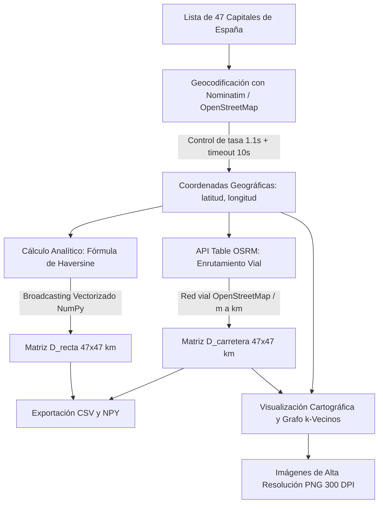

# Documentación Técnica y Metodológica: Construcción de Matrices de Distancias para el Problema del Viajero (TSP)

**Asignatura:** Redes Neuronales y Algoritmos Bioinspirados  
**Proyecto:** Trabajo 1 - Parte 2: Problema del Agente Viajero (TSP) en las Capitales de España Peninsular  
**Autor:** Gianca  
**Fecha:** Octubre 2026  

---

## Resumen Ejecutivo

El presente documento describe la metodología técnica, formulación matemática e implementación computacional empleada para la construcción de los conjuntos de datos del **Problema del Agente Viajero (TSP - *Traveling Salesperson Problem*)** sobre las 47 capitales de provincia de la España peninsular. 

Se desarrollaron dos matrices de costos de dimensión $47 \times 47$:
1. **Matriz Geodésica ($D_{\text{recta}}$):** Calculada analíticamente mediante la **Fórmula del Semiverseno (*Haversine*)** vectorizada en NumPy sobre la esfera terrestre.
2. **Matriz Vial Real ($D_{\text{carretera}}$):** Obtenida mediante el motor de enrutamiento **OSRM (*Open Source Routing Machine*)** sobre la infraestructura vial real de OpenStreetMap.

Ambas matrices proporcionan la base cuantitativa para la evaluación de algoritmos bioinspirados (Algoritmos Genéticos, Optimización por Enjambre de Partículas [PSO], Colonia de Hormigas [ACO], entre otros).

---

## 1. Definición del Problema e Instancia

El Problema del Agente Viajero es un problema clásico de optimización combinatoria clasificado como **NP-Hard**. Dado un conjunto finito de $N = 47$ nodos (ciudades) $V = \{v_1, v_2, \dots, v_N\}$ y una matriz de distancias o costos $D = (d_{ij})_{N \times N}$, el objetivo consiste en hallar una permutación cíclica $\pi = (\pi_1, \pi_2, \dots, \pi_N)$ que minimice la función objetivo de costo total de la ruta:

$$\min f(\pi) = \sum_{k=1}^{N-1} d_{\pi_k, \pi_{k+1}} + d_{\pi_N, \pi_1}$$

### Conjunto de Nodos Seleccionados
Se consideraron las 47 capitales provinciales situadas en la península ibérica (excluyendo los territorios insulares de Baleares y Canarias, y las ciudades autónomas de Ceuta y Melilla, con el fin de preservar la conexidad vial continua):

> *A Coruña, Albacete, Alicante, Almería, Ávila, Badajoz, Barcelona, Bilbao, Burgos, Cáceres, Cádiz, Castellón de la Plana, Ciudad Real, Córdoba, Cuenca, Girona, Granada, Guadalajara, Huelva, Huesca, Jaén, León, Lleida, Logroño, Lugo, Madrid, Málaga, Murcia, Ourense, Oviedo, Palencia, Pamplona, Pontevedra, Salamanca, San Sebastián, Santander, Segovia, Sevilla, Soria, Tarragona, Teruel, Toledo, Valencia, Valladolid, Vitoria-Gasteiz, Zamora, Zaragoza.*

---

## 2. Geocodificación y Adquisición de Datos

Para obtener las coordenadas espaciales $(\text{latitud}_i, \text{longitud}_i)$ de cada capital, se implementó un proceso de geocodificación directa mediante el servicio **Nominatim** provisto por la Fundación **OpenStreetMap (OSM)** a través de la librería Python `geopy`.

### Consideraciones Técnicas y Políticas de Uso
1. **Control de Frecuencia (*Rate Limiting*):** La política de uso aceptable de Nominatim (*Usage Policy*) restringe las peticiones automatizadas a un máximo estricto de **1 petición por segundo**. Por este motivo, se incorporó una pausa obligatoria:
   $$\Delta t = 1.1 \text{ segundos}$$
   entre consultas sucesivas, garantizando la estabilidad del servicio y evitando el bloqueo de la dirección IP cliente.
2. **Tolerancia a Latencia (*Timeout*):** Para mitigar fluctuaciones de red o latencia en el servidor público (que derivan en la excepción `GeocoderTimedOut`), se fijó un umbral de tiempo de espera explícito:
   $$\text{timeout} = 10 \text{ s}$$

```python
from geopy.geocoders import Nominatim
import time

geo = Nominatim(user_agent="tp-tsp-espana", timeout=10)
coords = []
for c in ciudades_espana:
    loc = geo.geocode(f"{c}, España")
    if loc is not None:
        coords.append((loc.latitude, loc.longitude))
    time.sleep(1.1)
```

Las coordenadas resultantes se expresaron en grados decimales:
$$\text{coords}_i = (\phi_i, \lambda_i) \in [-90^\circ, 90^\circ] \times [-180^\circ, 180^\circ]$$

---

## 3. Matriz de Distancias en Línea Recta ($D_{\text{recta}}$)

### 3.1. Fundamento Matemático: Fórmula del Semiverseno (*Haversine*)
La distancia más corta entre dos puntos situados sobre la superficie de una esfera se denomina distancia de círculo máximo (*great-circle distance*). La fórmula del semiverseno evita errores de cancelación catastrófica para distancias pequeñas que ocurren en la ley esférica de los cosenos.

Dados dos puntos con latitud y longitud $(\phi_1, \lambda_1)$ y $(\phi_2, \lambda_2)$ convertidos a radianes:
$$\Delta \phi = \phi_2 - \phi_1, \quad \Delta \lambda = \lambda_2 - \lambda_1$$

El semiverseno del ángulo central $\Theta$ se define como:
$$a = \operatorname{hav}(\Theta) = \sin^2\left(\frac{\Delta \phi}{2}\right) + \cos(\phi_1) \cdot \cos(\phi_2) \cdot \sin^2\left(\frac{\Delta \lambda}{2}\right)$$

La distancia angular central $\Theta$ (en radianes) es:
$$\Theta = 2 \cdot \arcsin(\sqrt{a})$$

Multiplicando por el radio medio volumétrico de la Tierra establecido por la IUGG ($R \approx 6371.0\text{ km}$), se obtiene la distancia física:
$$d_{\text{recta}}(i, j) = 2 R \cdot \arcsin\left(\sqrt{\sin^2\left(\frac{\phi_j - \phi_i}{2}\right) + \cos(\phi_i)\cos(\phi_j)\sin^2\left(\frac{\lambda_j - \lambda_i}{2}\right)}\right)$$

### 3.2. Implementación Vectorizada de Alto Rendimiento
En lugar de evaluar la fórmula iterativamente mediante bucles anidados en Python con complejidad e interpretación lenta, se aprovechó el mecanismo de **difusión multidimensional (*Broadcasting*)** de NumPy:

```python
# coords_rads: Matriz columna (N, 1) para broadcasting
coords_rads = np.radians(np.array(coords))
lat = coords_rads[:, 0][:, None]  # Forma (47, 1)
lon = coords_rads[:, 1][:, None]  # Forma (47, 1)

# Diferencias cruzadas matriciales (47, 47)
dlat = lat - lat.T
dlon = lon - lon.T

a = np.sin(dlat / 2)**2 + np.cos(lat) * np.cos(lat.T) * np.sin(dlon / 2)**2
D_recta = 2 * 6371.0 * np.arcsin(np.sqrt(a))  # km, simétrica, diagonal en cero
```

Propiedades algebraicas de $D_{\text{recta}}$:
* **No negatividad:** $d_{ij} \ge 0 \quad \forall i, j$.
* **Identidad de los indiscernibles:** $d_{ii} = 0 \quad \forall i$.
* **Simetría estricta:** $d_{ij} = d_{ji} \quad \forall i, j$.
* **Desigualdad triangular:** $d_{ik} \le d_{ij} + d_{jk}$ (espacio métrico euclidiano esférico).

---

## 4. Matriz de Distancias por Carretera ($D_{\text{carretera}}$)

### 4.1. Limitaciones del Modelo Geodésico
En el mundo real, los vehículos de transporte no se desplazan en línea recta ni en trayectoria ortodrómica. La distancia geodésica ignora:
* Barreras geográficas naturales (Cordillera Cantábrica, Sistema Central, Sierra Morena, valles fluviales).
* La topología de la red vial (autopistas, autovías, carreteras de un solo sentido).
* Restricciones de trazado y velocidad de diseño.

En ingeniería del transporte se modela esta discrepancia mediante el **factor de circuidad o tortuosidad** ($\tau$):
$$\tau_{ij} = \frac{d_{\text{carretera}}(i, j)}{d_{\text{recta}}(i, j)} \ge 1.0$$
En la península ibérica, este factor oscila típicamente entre $1.20$ y $1.65$.

### 4.2. Integración con la API Table de OSRM
Se empleó el motor de código abierto **OSRM (*Open Source Routing Machine*)**, basado en algoritmos de jerarquía de contracción (*Contraction Hierarchies*) sobre el grafo de vías transitables de OpenStreetMap.

Se invocó el servicio **Table**:
```http
GET http://router.project-osrm.org/table/v1/driving/{lon1,lat1;lon2,lat2;...}?annotations=distance
```

#### Protocolo y Conversión
1. **Formato de Coordenadas:** OSRM exige expresamente el par `(longitud, latitud)` en grados decimales (a diferencia del estándar cartográfico inverso `lat, lon`).
2. **Conversión de Unidades:** La respuesta JSON entrega las distancias en metros (`data["distances"]`), las cuales fueron convertidas a kilómetros:
   $$D_{\text{carretera}} = \frac{D_{\text{OSRM}}}{1000.0}$$

```python
coords_str = ";".join([f"{lon:.6f},{lat:.6f}" for lat, lon in coords_grados])
url = f"http://router.project-osrm.org/table/v1/driving/{coords_str}?annotations=distance"
response = requests.get(url, timeout=30)
data = response.json()

if data.get("code") == "Ok":
    D_carretera = np.array(data["distances"]) / 1000.0
```

### 4.3. Comparativa Empírica: Geodésica vs Carretera
Un ejemplo revelador de la importancia del modelado vial es el par **Lugo – Oviedo**:
* **Distancia en línea recta ($D_{\text{recta}}$):** $\approx 132.5\text{ km}$
* **Distancia real por carretera ($D_{\text{carretera}}$):** $\approx 228.8\text{ km}$
* **Factor de tortuosidad observado:** $\tau \approx 1.73$ (+72.7% de distancia adicional).

*Explicación geográfica:* Debido a que la cordillera Cantábrica y las sierras orientales gallegas imponen un relieve abrupto sin autopista directa perpendicular, el trazado carretero obliga a rodear por la autovía del Cantábrico (A-8) hacia la costa antes de conectar con el interior.

---

## 5. Visualización del Grafo y Análisis de Conectividad

Para validar visualmente la coherencia topológica de los datos, se generaron dos representaciones cartográficas:

### 5.1. Mapa de Dispersión Geográfico
Representa las 47 ciudades en coordenadas cilíndricas equivalentes (longitud en abscisas, latitud en ordenadas), asegurando la relación de aspecto real mediante `plt.axis('equal')`.

### 5.2. Grafo Vial de $k$-Vecinos Cercanos (*Nearest Neighbors Graph*)
Para cada ciudad $i$, se identificaron sus $k = 4$ conexiones más cercanas por carretera:
$$\mathcal{N}_k(i) = \operatorname{arg\,min}_{j \ne i}^{(k)} \{ d_{\text{carretera}}(i, j) \}$$

Se dibujaron los aristas correspondientes con etiquetas numéricas de kilometraje y se calculó el índice de accesibilidad global de cada ciudad a través de su distancia media al resto de la red:
$$\bar{d}_i = \frac{1}{N - 1} \sum_{j \ne i} d_{\text{carretera}}(i, j)$$

Esta métrica colorea el nodo en una escala de gradiente (*plasma*):
* **Ciudades centrales (baja $\bar{d}$):** Madrid, Toledo, Ciudad Real ($\approx 350 - 420\text{ km}$).
* **Ciudades periféricas (alta $\bar{d}$):** A Coruña, Cádiz, Girona ($\approx 750 - 850\text{ km}$).

---

## 6. Persistencia y Formatos de Almacenamiento

El pipeline genera dos esquemas complementarios de persistencia de datos:

1. **Formato Binario `.npy` (`numpy.save`):**
   * *Propósito:* Consumo computacional intensivo por parte de algoritmos bioinspirados.
   * *Ventajas:* Almacena exactamente los flotantes de 64 bits en formato binario contiguo en memoria, garantizando carga instantánea en $\mathcal{O}(1)$ I/O sin coste de parseo léxico.
2. **Formato Tabular `.csv` (`pandas.DataFrame.to_csv`):**
   * *Propósito:* Legibilidad humana, interoperabilidad con Excel y generación de reportes.
   * *Configuración:* Codificación `utf-8-sig` (Byte Order Mark) para preservar correctamente los caracteres ortográficos del español (tildes, diéresis y la virgulilla de la "ñ").

---

## 7. Diagrama del Flujo Metodológico



---

## 8. Referencias Bibliográficas

1. **Applegate, D. L., Bixby, R. E., Chvátal, V., & Cook, W. J. (2006).**  
   *The Traveling Salesman Problem: A Computational Study.* Princeton University Press.
2. **Sinnott, R. W. (1984).**  
   *Virtues of the Haversine.* Sky and Telescope, 68(2), 159.
3. **Luxen, D., & Vetter, C. (2011).**  
   *Real-time routing with Open Source Routing Machine.* Proceedings of the 19th ACM SIGSPATIAL International Conference on Advances in Geographic Information Systems (GIS '11), pp. 513–516. DOI: [10.1145/2093973.2094062](https://doi.org/10.1145/2093973.2094062).
4. **Haklay, M., & Weber, P. (2008).**  
   *OpenStreetMap: User-Generated Street Maps.* IEEE Pervasive Computing, 7(4), 12–18. DOI: [10.1109/MPRV.2008.80](https://doi.org/10.1109/MPRV.2008.80).
5. **Ballou, R. H., Rahbar, H., & Amini, M. M. (2002).**  
   *Development of actual highway distances from network data.* Transportation Research Part E: Logistics and Transportation Review, 38(4), 267–281.
6. **Harris, C. R., Millman, K. J., van der Walt, S. J., et al. (2020).**  
   *Array programming with NumPy.* Nature, 585(7825), 357–362. DOI: [10.1038/s41586-020-2649-2](https://doi.org/10.1038/s41586-020-2649-2).
7. **OpenStreetMap Foundation (2024).**  
   *Nominatim Usage Policy (Fair Use).* Recuperado de: [https://operations.osmfoundation.org/policies/nominatim/](https://operations.osmfoundation.org/policies/nominatim/)
8. **Project OSRM (2024).**  
   *OSRM HTTP API Documentation: Table Service.* Recuperado de: [http://project-osrm.org/docs/v5.24.0/api/#table-service](http://project-osrm.org/docs/v5.24.0/api/#table-service)
